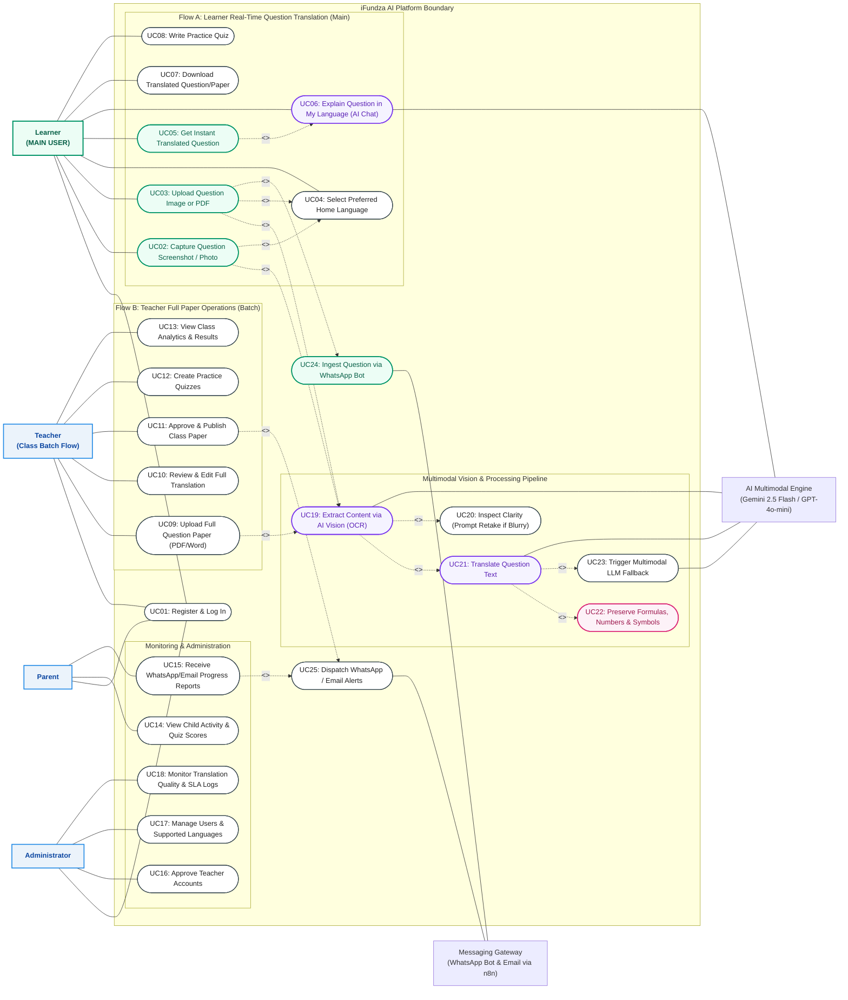

# iFundza AI - UML Use Case Specification & Diagram (Updated Draft)

## 1. System Overview & Architecture Evolution

**iFundza AI** empowers South African high school learners (especially from rural and disadvantaged backgrounds) to master Mathematics and Physical Sciences in their home languages (isiZulu, isiXhosa, Sepedi, Setswana, Sesotho, Afrikaans, etc.) by integrating state-of-the-art multimodal AI models.

### Architecture Shift: Two Unified Flows
* **Flow A - Learner Real-time Screenshot/Upload (Primary Main Flow)**:
  A learner takes a photo or screenshot of a question directly from a textbook, past paper, or classroom board (or uploads an image/PDF via the web app or WhatsApp). The system uses **Gemini 2.5 Flash Multimodal Vision** to read and extract text, mathematical formulas, and scientific diagrams, translates the question into the learner's home language while preserving notation and marks, and allows the learner to immediately ask: *"Explain this in my language"*.
* **Flow B - Teacher Full Paper Translation (Secondary Batch Flow)**:
  Teachers upload complete question papers (PDF/Word). The AI translates the document, the teacher reviews and approves the side-by-side translation, and it is published to the class with automated WhatsApp/Email alerts.

---

## 2. System Actors

### 2.1 Primary Human Actors
| Actor | Role & Priority | Main Actions |
| :--- | :--- | :--- |
| **Learner** | **Main User (Primary Actor)** | Captures screenshot or takes photo of question; uploads image/PDF; selects home language; receives instant translation; asks AI for step-by-step explanations in home language; completes quizzes; downloads translated material. |
| **Teacher** | Secondary / Class Actor | Uploads full question papers; reviews and approves automated translations; creates quizzes; posts announcements; tracks class analytics. |
| **Parent** | Monitoring Actor | Views child's translation activity, downloads, and quiz scores; receives automated progress summaries via WhatsApp and Email. |
| **Administrator** | Governance & Quality Actor | Approves teacher accounts; manages users and supported South African languages; monitors multimodal translation accuracy and SLA logs. |

### 2.2 Secondary / System Actors
| Actor | Role & Integration |
| :--- | :--- |
| **AI Multimodal Engine** | **Gemini 2.5 Flash Vision** (Primary for OCR, diagram understanding, and home language translation); **GPT-4o-mini Vision** (Standby failover). |
| **Messaging Gateway** | **WhatsApp Bot & Email Service** (orchestrated via n8n) for receiving question photos via chat and sending alerts/reports. |
| **Database & Storage** | **PostgreSQL (Supabase)** storing original images/screenshots, extracted text, translated questions, and quiz results. |

---

## 3. Updated UML Use Case Diagram

---

## 4. Detailed Use Case Specifications (Updated Focus)

### UC02 & UC03: Capture Screenshot / Upload Question (Learner Flow A)
- **Primary Actor**: Learner
- **Preconditions**: Learner opens the iFundza AI web app or WhatsApp bot.
- **Includes**: `UC04: Select Preferred Home Language`, `UC19: Extract Content via AI Vision (OCR)`.
- **Extends**: `UC24: Ingest Question via WhatsApp Bot`.
- **Main Success Scenario**:
  1. Learner snaps a photo or takes a screenshot of a Maths or Science question (from a textbook, whiteboard, or exam paper).
  2. Learner chooses their preferred South African home language (e.g. isiZulu, Sepedi).
  3. System uploads the image to the n8n ingestion pipeline and invokes Gemini 2.5 Flash Multimodal Vision.
  4. System extracts text, algebraic formulas ($2x + 3 = 7$), chemical equations ($\text{H}_2\text{O}$), and diagram labels.
  5. System translates the question text into the selected language, preserving all notation and marks.
  6. The translated question is displayed instantly to the learner with the option to ask for an explanation.

---

### UC20: Inspect Image Clarity (Prompt Retake if Blurry)
- **Primary Actor**: AI Multimodal Engine (Gemini Vision)
- **Trigger**: System detects low resolution, blurry text, or cut-off questions.
- **Main Success Scenario**:
  1. AI Vision inspects image readability during OCR preprocessing.
  2. If the question text or formula is illegible, the system responds: *"Please retake photo, the question is not clear or is cut off."*
  3. Learner is prompted to recapture the photo with better lighting and framing.

---

### UC22: Preserve Formulas, Numbers & Symbols
- **Primary Actor**: AI Translation Engine
- **Business Translation Rules**:
  - **Translate ONLY**: Explanatory wording and natural language instructions.
  - **DO NOT Translate**: Numbers ($1, 2, 3.5$), algebraic variables and powers ($x^2, 2x+3=7$), chemical symbols ($\text{H}_2\text{O}, \text{CO}_2$), SI units ($\text{cm}, \text{kg}, \text{m/s}$), and diagram labels.
  - **DO NOT Change**: Question numbering (Q1.1, Q2) or marks ($[3\text{ marks}]$).
  - **Diagrams**: Provide home-language descriptive text while leaving diagram structural labels in their original English/scientific format.

---

### UC06: Explain Question in My Language (AI Chat Assistant)
- **Primary Actor**: Learner
- **Secondary Actor**: AI Multimodal Engine (Gemini 2.5 Flash)
- **Trigger**: Learner clicks "Explain this in my language" on an already translated question.
- **Main Success Scenario**:
  1. System passes the original question, translated question, and learner language context to Gemini.
  2. AI responds in simple, learner-friendly language breaking down the mathematical/scientific concept step-by-step.
  3. Learner can ask follow-up questions in their home language.

---

### UC09 - UC11: Full Paper Upload & Approval (Teacher Flow B)
- **Primary Actor**: Teacher
- **Main Success Scenario**:
  1. Teacher uploads full exam paper (PDF or Word).
  2. AI Vision and Translation Engine processes the entire document.
  3. Teacher audits the side-by-side translation before approving.
  4. Upon approval, n8n triggers automated WhatsApp/Email alerts to enrolled learners and parents.

---

## 5. Updated Requirements Traceability Matrix (FR1 - FR8)

| Requirement | Description | Core Use Cases | Primary Actor |
| :--- | :--- | :--- | :--- |
| **FR1 (NEW)** | Capture screenshot / take photo of question from textbook, paper, or board | `UC02` | Learner |
| **FR2 (NEW)** | Upload question image (JPG/PNG), PDF, or screenshot | `UC03`, `UC24` | Learner |
| **FR3 (NEW)** | Multimodal AI Vision extraction of text, formulas, diagrams (handwritten/printed) | `UC19`, `UC20` | AI Engine (Gemini Vision) |
| **FR4** | Translate to selected home language without changing formulas or numbers | `UC04`, `UC21`, `UC22`, `UC23` | AI Engine |
| **FR5** | Allow Teacher to upload full papers for review and publication | `UC09`, `UC10`, `UC11` | Teacher |
| **FR6** | Allow Learner to chat with AI for step-by-step explanation in home language | `UC06` | Learner / AI Engine |
| **FR7** | Allow Learner to download translated question / paper | `UC07` | Learner |
| **FR8** | Save all original images, translations, and quizzes to Postgres for reuse | `UC05`, `UC09`, `UC14` | Database / System |
