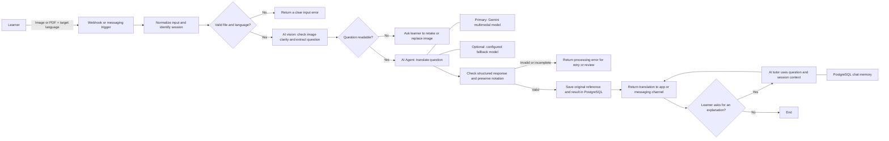

# Proposed n8n AI-agent workflow

This document describes a planned integration. It is not an exported or configured n8n workflow; the application backend, provider credentials, webhook URLs, and database connection still need to be set up.

## Goal

Let a learner submit a Mathematics or Physical Sciences question as an image, get a translation into a selected South African home language, and optionally ask an AI tutor for an explanation.

## Learner image-to-translation workflow



## Suggested n8n nodes

| Order | Node | Responsibility |
| --- | --- | --- |
| 1 | **Webhook** or **WhatsApp trigger** | Receive a learner's image/document, target language, and session identifier. |
| 2 | **Code** or **Edit Fields** | Normalize the request into consistent fields for the rest of the workflow. Keep binary file data attached. |
| 3 | **IF** | Reject unsupported file types, missing language selections, or requests over configured size limits. |
| 4 | **AI vision / AI Agent** | Check readability, extract the question, and translate only the natural-language wording. Use the chosen multimodal model; configure a fallback only if an approved provider is available. |
| 5 | **Structured Output Parser** or **Code** | Validate the response fields and check that original formulas, numbers, units, marks, and question labels are retained. Send questionable results to review rather than presenting them as successful. |
| 6 | **Postgres** | Save the request, extracted text, target language, translation, and processing status. Store images in suitable object storage and save a reference rather than a large binary in the database. |
| 7 | **Respond to Webhook** or **WhatsApp** | Return the translation and a clear retry message when the upload cannot be read. |
| 8 | **AI Agent + Postgres Chat Memory** | Handle follow-up requests using the original question, translation, selected language, and conversation context. |

The trigger and reply nodes depend on the channel: a web application can call a webhook, while WhatsApp needs a supported messaging integration. Keep learner and session identifiers consistent across the entry, storage, and reply steps.

## Translation response contract

Have the AI return a predictable object for validation before it is sent to the learner:

```json
{
  "status": "ok",
  "source_text": "The extracted question text",
  "translated_text": "The question translated into the selected language",
  "target_language": "isiZulu",
  "readability": "clear",
  "needs_review": false
}
```

If the image is unclear, return a non-success status and a retake prompt. Do not invent missing question content. The application should separately preserve the original image or a secure file reference.

## Teacher paper workflow

Treat full-paper translation as a separate path: teacher uploads a document → AI extracts and translates pages → teacher reviews the side-by-side result → teacher approves publication → n8n sends class notifications by email or WhatsApp. Do not notify learners or parents before teacher approval.

## Setup and safety notes

- Add model, database, and messaging credentials through n8n's credential manager; do not put secrets in workflow code or exported JSON.
- Protect the webhook with authentication and validate file type and size before processing.
- Limit access to uploaded learner content and stored conversation history.
- Log failures and processing status without exposing credentials or unnecessary learner data.
- Configure and test the primary and fallback models, language coverage, notation preservation, and unclear-image response before using the workflow with learners.
